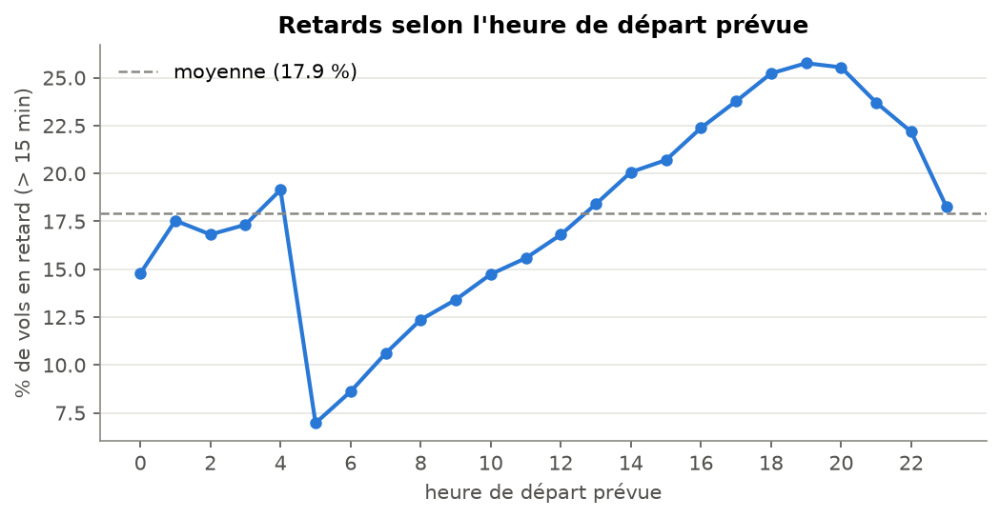
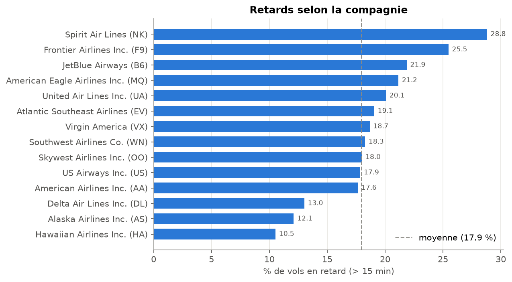
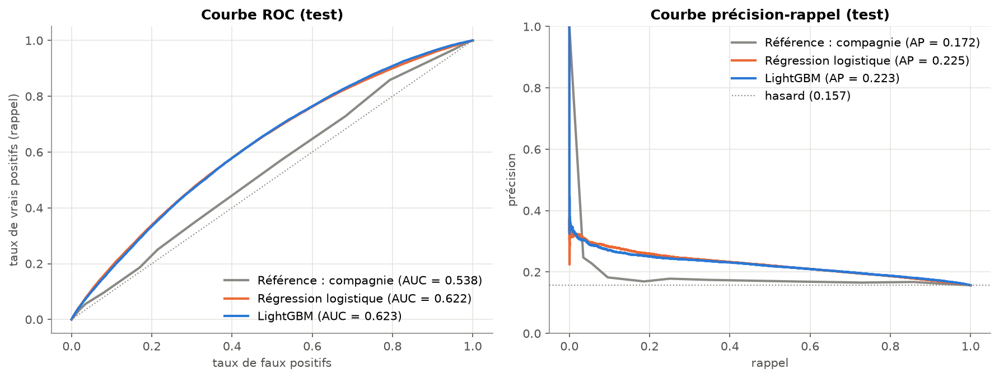
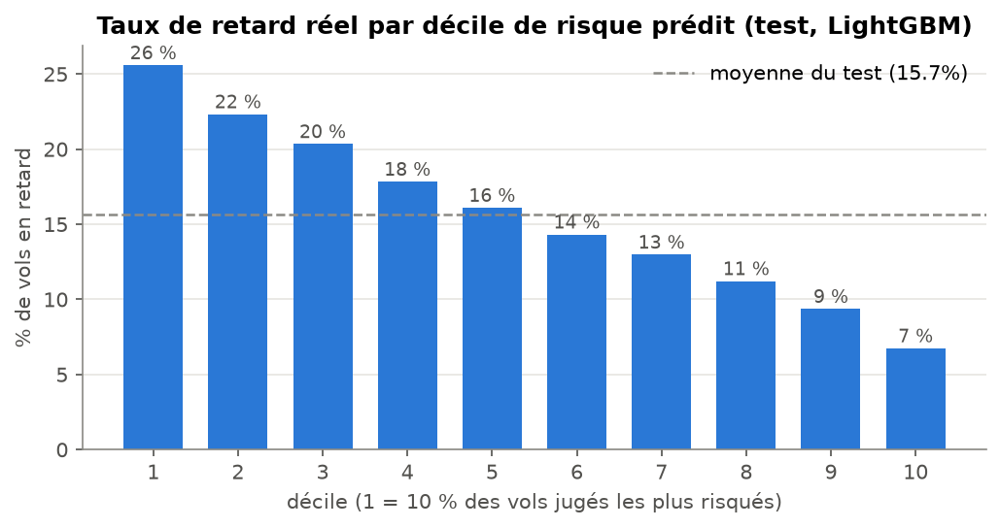
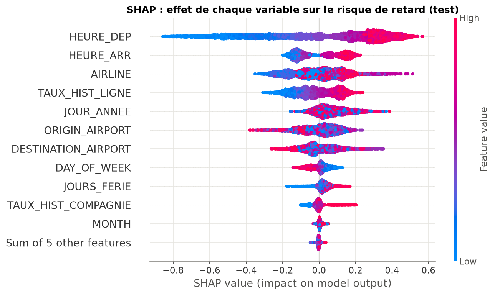

# ✈️ Prédire les retards d'avion au moment de la réservation

Projet de machine learning sur données tabulaires. On prédit, **avant le départ**, si un vol intérieur américain arrivera avec **plus de 15 minutes de retard**, et on identifie les facteurs qui comptent le plus.

➡️ Le notebook principal, lisible de haut en bas : [`notebooks/retards_avion.ipynb`](notebooks/retards_avion.ipynb)

## Le problème et son intérêt pour le voyage

Environ **1 vol sur 5** arrive avec plus de 15 minutes de retard. Un indicateur de risque calculé **dès la réservation** peut servir à :
- afficher un niveau de fiabilité à côté de chaque vol sur un comparateur ou un site de réservation ;
- proposer automatiquement une **correspondance plus longue** quand le premier vol est à risque ;
- anticiper la charge du service client et des réacheminements.

Contrainte essentielle : au moment de la réservation, on ne connaît **ni la météo du jour, ni le retard au départ, ni l'état de l'avion précédent**. Le modèle doit faire avec les seules informations du programme de vols.

## Données et préparation

- **Source :** [2015 Flight Delays and Cancellations](https://www.kaggle.com/datasets/usdot/flight-delays) (U.S. Department of Transportation), 5 819 079 vols intérieurs de 2015, téléchargés automatiquement avec `kagglehub`.
- **Nettoyage :** on retire les vols annulés ou déroutés (il reste 5 712 914 vols), puis on tire un **échantillon de 1 500 000 vols** (paramétrable) avec des types compacts. Le chargement prend environ 45 s et environ 1,5 Go de mémoire au pic, sur un Mac M2 avec 8 Go.
- **Octobre 2015 :** dans le fichier, les aéroports de ce mois sont codés par des identifiants numériques du DOT (« 12478 ») au lieu des codes IATA (« JFK »). Plutôt que de supprimer le mois, la correspondance est **reconstruite** en appariant les vols réguliers d'octobre avec ceux de septembre et novembre (même compagnie, même numéro de vol, même horaire, même distance). On obtient **300 codes reconstruits**, vérifiés sur les identifiants officiels connus (12478 = JFK, 13930 = ORD…). Seuls 1 097 vols sont perdus, contre 486 165 si l'on supprimait le mois entier.
- **Cible :** `RETARD = 1` si le retard à l'arrivée dépasse 15 minutes (17,9 % des vols de l'échantillon).

### Ce que montre l'analyse exploratoire

| | |
|---|---|
|  |  |

- **L'heure de départ** est l'effet le plus net : de 7 % de retards à 5 h jusqu'à près de 26 % vers 19 h, à cause de l'effet « boule de neige » des rotations d'avions.
- **La compagnie** fait presque tripler le risque : de 10,5 % (Hawaiian) à 28,8 % (Spirit).
- **La saison** compte : pics en juin (22,9 %) et en février (22,3 %), creux en septembre et octobre (environ 12 %).

## Méthode et choix importants

**1. Aucune fuite de données.** Les colonnes connues seulement pendant ou après le vol (`DEPARTURE_DELAY`, `TAXI_OUT`, `WHEELS_OFF`, `AIR_TIME`, `ARRIVAL_TIME`, causes de retard…) ne sont **même pas lues**. Avec `DEPARTURE_DELAY`, le score serait excellent, mais le modèle serait inutile au moment de la réservation.

**2. Variables utilisées** (toutes connues à la réservation) :
- **Horaires et calendrier :** heures de départ et d'arrivée prévues, jour de la semaine, mois, jour de l'année, distance au jour férié le plus proche.
- **Vol :** compagnie, aéroports, distance, durée prévue.
- **Trafic prévu :** départs programmés depuis l'aéroport dans la même heure, calculés sur le programme complet avant échantillonnage.
- **Taux de retard historiques** (mon amélioration), par aéroport de départ, aéroport d'arrivée, compagnie et **ligne**, avec trois garde-fous contre la fuite :
  - sur l'entraînement, seuls les jours **antérieurs** au vol sont utilisés ;
  - sur la validation et le test, les taux sont **figés** à la date de coupure ;
  - un **lissage bayésien** `(retards + m × taux_global) / (vols + m)` protège les petites catégories.
  - L'absence de fuite est **vérifiée explicitement** par un test de perturbation, dans le notebook et dans `tests/`. Modifier les cibles futures ne change aucune valeur passée.

**3. Séparation temporelle, jamais aléatoire.**

| Jeu | Période | Vols | Taux de retard |
|---|---|---|---|
| Entraînement | janvier → juillet | 874 749 | 19,7 % |
| Validation | août | 132 338 | 18,1 % |
| Test | septembre, novembre, décembre | 366 264 | 15,7 % |

La validation sert à l'arrêt anticipé de LightGBM et au **choix du seuil**. Le test sert uniquement à l'évaluation finale.

**4. Métriques adaptées au déséquilibre.** On utilise la **ROC-AUC** et la **PR-AUC** (le hasard vaut la part de retards), puis la précision, le rappel et le F1 au seuil qui maximise le F1 **sur la validation**. L'exactitude est trompeuse ici : répondre toujours « à l'heure » donne déjà 84 %.

**5. Modèles.**
- Deux références naïves : une probabilité constante, et le taux historique de la compagnie.
- Une régression logistique (catégories en one-hot, heure en catégorie).
- **LightGBM**. Il est préféré à XGBoost sur Mac M2 avec 8 Go : il gère nativement les catégories, il est rapide et économe en mémoire sur processeur grâce à ses histogrammes, et il ne demande pas de GPU.

## Résultats

Résultats **sur le test** (septembre, novembre, décembre), avec les seuils choisis sur la validation :

| Modèle | ROC-AUC | PR-AUC | Précision | Rappel | F1 |
|---|---|---|---|---|---|
| Référence : constante (hasard) | 0,500 | 0,157 | 0,157 | 1,000 | 0,271 |
| Référence : taux historique de la compagnie | 0,538 | 0,172 | 0,166 | 0,743 | 0,271 |
| Régression logistique | 0,622 | **0,225** | 0,197 | 0,712 | 0,308 |
| **LightGBM** | **0,623** | 0,223 | 0,205 | 0,645 | **0,311** |

Sur la validation (août), LightGBM obtient une ROC-AUC de 0,658, contre 0,646 pour la régression logistique.



**Ce qu'il faut retenir :**
- **Les modèles battent nettement les références.** La PR-AUC passe de 0,157 (hasard) à environ 0,22, soit +42 %. Les scores restent modestes, et c'est attendu sans météo ni retard de l'avion précédent. Aucun signe de fuite : la ROC-AUC est de 0,72 sur l'entraînement et de 0,62 sur le test.
- **Le modèle trie bien les vols par niveau de risque.** Les 10 % de vols jugés les plus risqués ont **25,6 %** de retards, soit **3,8 fois plus** que les 10 % jugés les plus sûrs (6,7 %).

  

- **LightGBM et la régression logistique sont à égalité sur le test.** L'avantage de LightGBM en validation disparaît quand on prédit plusieurs mois à l'avance.
- **Taux historiques (mon amélioration), résultat honnête :** ils apportent environ **+0,008** de ROC-AUC et de PR-AUC à la régression logistique, mais **rien** à LightGBM, qui apprend déjà les effets des compagnies et des aéroports à partir des variables catégorielles.

### Interprétation (SHAP)



En français simple : **l'heure de départ prévue** est de loin le premier facteur, car plus le vol part tard, plus il hérite des retards accumulés dans la journée. Viennent ensuite **la compagnie**, **la ligne** (le taux historique de la ligne est la 4e variable selon SHAP) et **les aéroports**, puis les jours fériés et le jour de la semaine. La distance, la durée prévue et le trafic de l'heure n'apportent presque rien de plus.

### Analyse des erreurs

- **Le matin**, le modèle manque 85 % des retards, qui sont rares et imprévisibles. **Le soir**, il signale presque tous les vols (90 % de fausses alertes entre 17 h et 20 h).
- Les vols les moins bien triés partent des hubs exposés à la météo : **Denver, Dallas et Chicago O'Hare** (ROC-AUC entre 0,56 et 0,57).
- Le modèle ne repère **pas mieux les gros retards** (plus de 2 h) que les petits (15 à 30 min). Ces retards graves viennent d'événements imprévisibles à la réservation.

### Exemple d'utilisation

```python
predire_vol("AA", "JFK", "LAX", 9, 15, 700, 1015, 2475, 375)    # → 13 % (mardi de septembre, 7 h)
predire_vol("NK", "ORD", "LGA", 11, 25, 1900, 2215, 733, 135)   # → 45 % (veille de Thanksgiving, 19 h)
```

## Limites et pistes d'amélioration

**Limites**
- Pas de **météo du jour** ni de **retard de l'avion précédent**, les deux grandes causes de retard.
- **Une seule année (2015).** Le modèle n'a jamais vu septembre ni décembre : il ne peut pas apprendre leur saisonnalité. Sa probabilité moyenne reste autour de 21 % alors que le taux réel varie de 12 % à 20 % selon le mois du test, donc les probabilités sont mal calibrées dans le temps. Le paysage aérien a aussi changé depuis 2015 (fusions de compagnies).
- Les taux historiques sont calculés sur l'**échantillon** de 1,5 million de vols, et sont donc plus bruités que sur les 5,7 millions.
- **Note de méthode :** une première version réentraînait le modèle sur janvier-août avec un seuil choisi pour un autre modèle. L'erreur a été corrigée après avoir regardé le test une fois, et c'est documenté dans le notebook. Aucun autre choix n'a été fait au vu du test.

**Pistes**
1. Ajouter des prévisions **météo** (NOAA) pour des prédictions quelques jours avant le départ.
2. Utiliser **plusieurs années** de données BTS et une validation glissante sur plusieurs mois.
3. Exploiter la **rotation des avions** (`TAIL_NUMBER`) pour une prédiction le jour même.
4. **Recalibrer** les probabilités (régression isotonique sur une période récente).
5. Tester CatBoost ou XGBoost, puis déployer une application **Streamlit** autour de `predire_vol`.

## Lancer le projet

Prérequis : Python 3.12 ou plus récent (testé avec 3.14) et, sur macOS, `libomp` pour LightGBM.

```bash
brew install libomp                 # macOS uniquement
python3 -m venv .venv
source .venv/bin/activate
pip install -r requirements.txt

pytest -q                           # 13 tests (données synthétiques, quelques secondes)
jupyter notebook notebooks/retards_avion.ipynb   # puis « Run All » (environ 1 min 15 s sur Mac M2)
```

**Données.** Le notebook télécharge automatiquement le jeu avec `kagglehub`, sans compte Kaggle, et le met en cache dans `~/.cache/kagglehub`. Si le téléchargement échoue :
1. Téléchargez l'archive sur <https://www.kaggle.com/datasets/usdot/flight-delays> (bouton *Download*, compte Kaggle gratuit nécessaire).
2. Décompressez-la et placez `flights.csv`, `airlines.csv` et `airports.csv` dans le dossier `data/` du projet.

Le notebook utilise `data/` en priorité. Ce dossier est **ignoré par Git** : les données ne sont jamais versionnées.

Pour changer la taille de l'échantillon, modifiez `SAMPLE_SIZE` dans la section 1 du notebook (`None` pour garder tous les vols, ce qui demande plus de mémoire).

## Structure

```
data/                           # données (ignoré par Git)
notebooks/retards_avion.ipynb   # notebook principal
src/features.py                 # chargement, correction d'octobre, feature engineering, séparation temporelle
src/evaluation.py               # métriques, seuil, graphiques, analyse des erreurs
tests/test_features.py          # tests pytest : pas de fuite, codes d'aéroports, séparation temporelle
docs/figures/                   # graphiques exportés pour ce README
```
